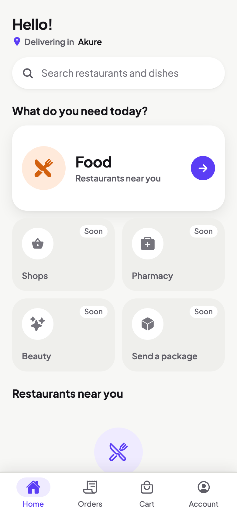

# Orderrite

[](https://github.com/peteropeyemijohn/Orderrite/actions/workflows/ci.yml)

**Order right. Delivered fast.**

Orderrite is a multi-category delivery app for Nigerian cities, starting in Akure, inspired by apps like Glovo and Chowdeck. Not affiliated with them. When finished, customers order food (and later shop, pharmacy, beauty and package deliveries) in a mobile app, independent riders deliver, vendors manage orders in a web dashboard, and an admin runs the platform.

It is built to grow: countries, cities, currencies and fees are data, not code.

> **Honest scope:** this is the **first test version**: **food only, Akure only**. Payments will run in Paystack **test mode** (no real money), and sign-in uses a fixed test code instead of SMS. Ordering, payments and rider tracking are still being built (see [the phase list](docs/PHASES.md)). What works today: sign-in for all four roles, the design system, the home screen and the deployed demo.

**Project docs:** [product requirements (PRD)](docs/PRD.md) · [phase list and status](docs/PHASES.md)

<p>
  
  &nbsp;&nbsp;
  
</p>

<sub>Screenshots from the app's web preview. On Android the login header is a violet gradient.</sub>

## Try the live demo

| | Link |
|---|---|
| Web dashboard (sign-in works; admin and vendor pages coming) | https://orderrite-apps.vercel.app |
| Android app (APK) | https://expo.dev/accounts/kalprice5/projects/orderrite/builds/cd624097-c278-459c-ac96-6e825a4e1b43 |
| API health check | https://orderrite-api.onrender.com/health |

The APK link may expire. The web demo keeps working.

⏳ **The first load can take about a minute.** The demo runs on free hosting that sleeps when nobody is using it. After it wakes up, it is fast.

### Demo logins

Everything on the demo uses the sign-in code **`123456`**.

| Role | Phone number | Where |
|---|---|---|
| Customer | `+234 000 000 0001` | Android app |
| Rider | `+234 000 000 0002` | Android app |
| Vendor | `+234 000 000 0003` | Web dashboard |
| Admin | `+234 000 000 0004` | Web dashboard |

The app and the dashboard show one-tap buttons for these accounts. You can also sign in with any new phone number using `123456`. New numbers become customer accounts. The demo uses its own database and contains no real people's data.

Installing the Android app: open the APK link on an Android phone, tap **Install**, and allow "install unknown apps" when asked. If Google Play Protect warns about an unknown app, choose **More details → Install anyway** (normal for test apps outside the Play Store). There is no iPhone build yet (that needs a paid Apple developer account).

## Tech stack

- **Mobile (customer + rider):** React Native, Expo, Expo Router, TypeScript
- **Web (vendor dashboard + admin panel):** Next.js (App Router), Tailwind CSS
- **API:** NestJS (REST), Prisma, PostgreSQL (Neon)
- **Auth:** phone number + one-time code, short-lived JWT access tokens and rotating refresh tokens
- **Shared package:** types, translations, design tokens and money formatting, shared by the mobile and web apps
- **Hosting (demo):** Render (API), Vercel (web), Neon (database), EAS Build (Android)
- **Tooling:** pnpm workspaces monorepo, Docker, GitHub Actions (type check, lint, tests, secret scan and a Docker smoke test on every push)

## Run it locally

### Quickest: Docker (API only, no accounts needed)

The API runs in Docker with its own local Postgres database. No accounts, keys or `.env` files are needed: every value in `docker-compose.yml` is a fake, local-only value.

```bash
docker compose up --build
```

This starts three containers:

1. **db**: a local PostgreSQL 17 database.
2. **migrate**: creates the tables and the starting data (Nigeria, Akure, fee settings and a local admin with the fake number `+234 000 000 0099`), then exits.
3. **api**: the API on http://localhost:4000, from a slim multi-stage image that runs as a non-root user and has a built-in health check.

Then check it:

```bash
curl http://localhost:4000/health          # {"status":"ok","database":"ok",...}
curl http://localhost:4000/config/public   # country, city (Akure) and currency
docker compose logs api                    # sign-in codes appear here (local only)
docker compose down -v                     # stop and delete the local database
```

Verified in GitHub Actions on every push and in a GitHub Codespace.

The image is defined in [`apps/api/Dockerfile`](apps/api/Dockerfile). The live demo still deploys to Render without Docker.

### Full setup with Neon

You need Node.js 24, pnpm, a free [Neon](https://neon.tech) PostgreSQL database and, for the phone app, [Expo Go](https://expo.dev/go).

```bash
pnpm install

# 1. Settings: copy the examples and fill in your own values (never commit them)
cp apps/api/.env.example apps/api/.env          # database strings, secrets, ADMIN_PHONE
cp apps/web/.env.example apps/web/.env.local
cp apps/mobile/.env.example apps/mobile/.env    # your computer's Wi-Fi address

# 2. Database
pnpm db:migrate
pnpm db:seed

# 3. Run (one terminal each)
pnpm --filter api dev       # http://localhost:4000/health
pnpm --filter web dev       # http://localhost:3000
pnpm --filter mobile start  # scan the QR code with Expo Go
```

Locally, sign-in codes are printed in the API terminal. Nothing is sent by SMS.

```bash
pnpm test            # all tests
pnpm typecheck
pnpm lint
pnpm check-secrets   # scan for keys before committing (runs automatically on commit)
```

## How I built it

I built Orderrite with **[Claude Code](https://claude.com/claude-code)**, an AI coding assistant, as my pair programmer. I'm new to app development, so the split was:

- **Me:** the product idea and scope (the [PRD](docs/PRD.md)), approving the phase plan and every plan before any code was written, all product and design decisions (brand colour, wordmark, icon, tagline), creating and configuring every account and dashboard (GitHub, Neon, Render, Vercel, Expo), and testing each phase on a real Android phone.
- **Claude Code:** most of the code, the tests, the deployment setup and plain-language explanations, working one phase at a time under the rules in [`CLAUDE.md`](CLAUDE.md).
- **Secrets:** I created the accounts and entered the real values myself, in git-ignored env files and in the hosting dashboards. I kept them out of the chat. Claude Code wrote the safeguards: ignore rules, and a scanner that runs on every commit and across the full history. Because an AI assistant working in my project folder can read local files, the public demo uses separate demo and test credentials only.

Guard rails I insisted on: a secret scan on every commit (and across the full history before any push), money stored as whole numbers in kobo, prices to be calculated only on the server, permission checks on protected endpoints, and Paystack in test mode only.

## Credits

- Login photo: jollof rice with chicken and plantain by [Keesha's Kitchen](https://unsplash.com/photos/a-plate-of-food-b4Ht8TQ1JGo) on Unsplash ([Unsplash License](https://unsplash.com/license)).
- Font: [Plus Jakarta Sans](https://fonts.google.com/specimen/Plus+Jakarta+Sans) (SIL Open Font License). The wordmark letters are outlines drawn from this font.
- Icons: [Ionicons](https://ionic.io/ionicons) (MIT License).

## Security notes

- No keys or secrets are stored in this repository. All settings come from environment variables, and every commit is scanned automatically.
- Protected endpoints require sign-in, and a role check is built in for endpoints limited to admins or vendors.
- Prices and totals will be calculated only on the server (ordering arrives in a later phase).
- Sign-in codes and refresh tokens are stored only as hashes. Login is rate limited per phone number and per IP address.

---

Copyright © 2026 Peter Opeyemi John. All rights reserved. · [GitHub: peteropeyemijohn](https://github.com/peteropeyemijohn)
